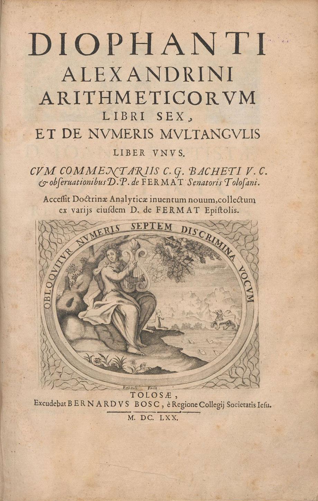

::: {.callout-note}
[Noah Jang](https://www.linkedin.com/in/noah-jang-2111392ba/) is the original creator of the exposition and examples referenced here. 
The interactive simulations, additional explanations, and contextual material are my own work on this site are my own work.

The original exposition and examples can be found back in Noah Jang's video [Proof of Fermat Last Theorem FROM SCRATCH](https://www.youtube.com/watch?v=9f-hGSh8lF0).
:::

### Who is this site meant for?

<figure style="width: 33%; float: right; margin: 0em 1em 0em 1em; display: flex; flex-direction: column; align-items: center;">
    
    <figcaption>
        <i><a href="https://en.wikipedia.org/wiki/Pierre_de_Fermat">Pierre de Fermat<a></i>
    </figcaption>
</figure>

This site is meant for anyone who is interested in mathematics and wants to understand the proof of 
Fermat's Last Theorem on a technical level without
the necessity of being and expert in number theory.

As the content is regularly illustrated with interactive
visualizations, it is especially targeted at 
people who are receptive to the beauty of pure mathematics and are interested 
to learn more about the context, easthetics, and 
interconnections between different areas of mathematics.

The proposed audience for this content would therefore
most likely consist of students, technically interested people, mathematics teachers, and anyone who wants to learn how to appreciate the beauty of purely mathematical structures even more.

---

::: {.callout-note}
Visualizations in this project are created with my own [Helion library](https://www.hendrikse.name/helion/).
:::

---

## Hype or holy grail?

For the Pythagoreans numbers weren't merely serving a practical purpose.
Instead, they regarded numbers as means to get a deeper and fundamental 
understanding of the structure of reality: 

> Tὰ ὄντα ἀριθμοί εἰσιν (the things that are, are numbers) &mdash; Paraphrase of a Pythagorean doctrine described by Aristotle ([_Metaphysics_](https://www.perseus.tufts.edu/hopper/text?doc=Perseus%3Atext%3A1999.01.0052%3Abook%3D1)).

In his [Metaphysics](https://www.perseus.tufts.edu/hopper/text?doc=Perseus%3Atext%3A1999.01.0052%3Abook%3D1), 
Aristotle describes their view by stating that they
viewed the principles of numbers ast the principles of all things. 
They thought that even the universe itself could be 
understood in terms of numbers and proportions. 

They may be seen as the main intellectual precursors to the 
[quadrivium](https://en.wikipedia.org/wiki/Quadrivium), 
consisting of the following disciplines:

- Artimetica: numbers on their own, the study of numbers and their mutual ratios
- Geometria: numbers in space, the study of shapes, sizes and spatial propertions
- Musica: numbers in time, the study of musical intervals and harmonic frequency ratios
- Astronomia: numbers in motion, the study of the motions of celestial bodies

<figure style="width: 45%; float: right; margin: 0em 1em 0em 1em; display: flex; flex-direction: column; align-items: center;">
    
    <figcaption>
        <i>Title page of the 1670 edition of Arithmetica, containing <a href="https://en.wikipedia.org/wiki/Pierre_de_Fermat">Pierre de Fermat<a>'s commentary &mdash; <a href="https://en.wikipedia.org/wiki/Diophantus#/media/File:Diophantus-cover-Fermat.jpg">Wikipedia</a>.</i>
    </figcaption>
</figure>

Still today, the theory of numbers is considered to be a fundamental
for obtaining access to a deeper understanding of mathematical structures. 

Going back to the Greeks again, 
[Diophantus of Alexandria](https://mathshistory.st-andrews.ac.uk/Biographies/Diophantus/)
is often regarded as the 'father of algebra'. He was the first to start a
systematic study on the theory of numbers and solutions to certain type of
algebraic equations in his famous book called 'Arithmetica'. As a consequence,
the equations that he studied are now called Diophantie equations and are of the
form:

$$
f(x_1, x_2, \ldots, x_n) = 0
$$

with integer coefficients, for which we can ask the following questions:

1. Are there any integer or rational solutions?
2. In case of any solutions, can we find them?
3. Can we describe _all_ such solutions?

Fermat's last theorem is a special case of such a Diophantine equation 
as we are looking for integers solutions to a function in 
the special case of merely three variables $x, y$, and $z$:

$$
x^n + y^n - z^n = 0\ \Leftrightarrow\ x^n + y^n = z^n
$$

Almost everybody will be familiar with the special case of $n=2$, 
in which case we end up with the famous [Pythagorean theorem](https://en.wikipedia.org/wiki/Pythagorean_theorem), 
for which one can relatively easily prove that infinitely many solutions exist.

Fermat's Last Theorem (FLT) makes a remarkably simple claim: if $n > 2$, 
there are no positive integers $x$, $y$, and $z$ that satisfy it, in stark
contrast with infinite number of solution for the case where $n=2$, where we may
have for example $3^2 + 4^2 = 5^2$.

So why should the case $n>2$ be so special?
And why did it take more than three centuries to prove?

Usually the story starts with that fact that in 1637 [Pierre de Fermat](https://en.wikipedia.org/wiki/Pierre_de_Fermat) wrote in the margin of a book that he had discovered a "truly marvelous" proof, but that the margin was too small to contain it. The problem remained unsolved for centuries, attracting some of the greatest mathematicians in history, until [Andrew Wiles](https://en.wikipedia.org/wiki/Andrew_Wiles) finally announced a proof in 1993.

I vividly remember my excitement when I read on [slashdot.org](https://slashdot.org) that Wiles' finally managed to provide a proof. But at the same time one may wonder whether my initial excitement was justified, or stated
differently: 

> **Is Fermat's Last Theorem genuinely mathematically interesting, or is it famous just because of the hype and the extraordinary story surrounding it?**

This project is an attempt to investigate this question.

## What does "from scratch" mean?

The purpose of this website is to follow that journey as carefully as possible. The goal is not merely to state Wiles' proof, or to give a high-level description such as

> "Frey constructed an elliptic curve, Ribet proved a theorem, and Wiles proved modularity."

That tells us *what happened*, but not necessarily *why*. Our approach is different in precisely this aspect: apart from introducing the necessary (fields of) mathematics, the intention is to keep asking the same question:

> **Why do we need this?**

If a new mathematical object appears, we should understand what problem it solves. If a theorem is introduced, we should understand why it is relevant. And when the argument becomes abstract, we should try to keep sight of the remarkably simple equation with which we started.

We will start with concepts that are familiar from undergraduate mathematics and gradually introduce the more advanced ideas that eventually become necessary. 

## From a simple equation to modern mathematics

The surprising part of Fermat's Last Theorem is not simply that the equation has no solutions. The surprising part is **what lies behind that simple statement**.

At first, FLT may seem to be a problem just about integers. We might therefore expect the proof to involve clever manipulations of integers, perhaps together with some increasingly sophisticated number theory. And indeed, that is how the story begins.

But in mathematics, we often encounter a problem in one field and eventually discover that its real structure is much easier to understand in another. As mathematicians tried to understand FLT more deeply, this happened as well. Not only did the problem itself turn out to be connected to different fields of mathematics, it also made use of some connections/bridges between those different fields:

* [Linear algebra](chapter-2/linear-algebra.qmd),
* [Abstract algebra](chapter-3/abstract-algebra.qmd) ([groups](chapter-3/groups.qmd) and [Galois theory](chapter-3/galois-theory.qmd)),
* Elliptic curves,
* Modular forms

Thus, a problem that begins with one of the simplest equations in 
number theory ultimately reaches some of the deepest structures of modern mathematics. 
So the topics discussed here are not simply a collection of increasingly 
complicated tools that happen to be useful for proving the theorem, but
constitute a means for the unification of the different fields in
mathematics as well ([Langlands program](https://en.wikipedia.org/wiki/Langlands_program)).
As such, it is very similar to the [standard model](https://en.wikipedia.org/wiki/Standard_Model) in physics, one of the greatest achievements in unifying the four different physical forces (except gravity).

In addition, its history spans more than two millennia: from the fascination of the Pythagoreans 
with numerical structures, through the arithmetic problems of Diophantus and Fermat's seventeenth-century investigations, to the theory of elliptic curves, modular forms, and Galois representations.

## My motivation

Fermat's Last Theorem is a particularly beautiful example of a recurring phenomenon in both physics and mathematics:

> **A simple question can lead us to a much deeper structure than we could have anticipated.**

For me, the history of Fermat's Last Theorem is therefore not merely the story of finding a proof. It is also the story of discovering connections between different fields of mathematics.

That is primarily what makes the theorem interesting to me.

* Not the hype.
* Not the legend of the margin.
* Not even the fact that it took more than three centuries to prove.

The interesting part is what structures are hiding underneath.

## A journey rather than a shortcut

This is not intended to be a reproduction of Wiles' original papers. Those papers are highly technical, and understanding every detail of the complete proof requires a substantial amount of modern mathematics.

Instead, this project aims to construct a coherent path toward the proof.

The hope is that, by the time we reach Wiles' proof, the reader will not necessarily be able to reproduce every technical argument from memory, but will understand the architecture of the proof and, more importantly, why the architecture looks the way it does.
